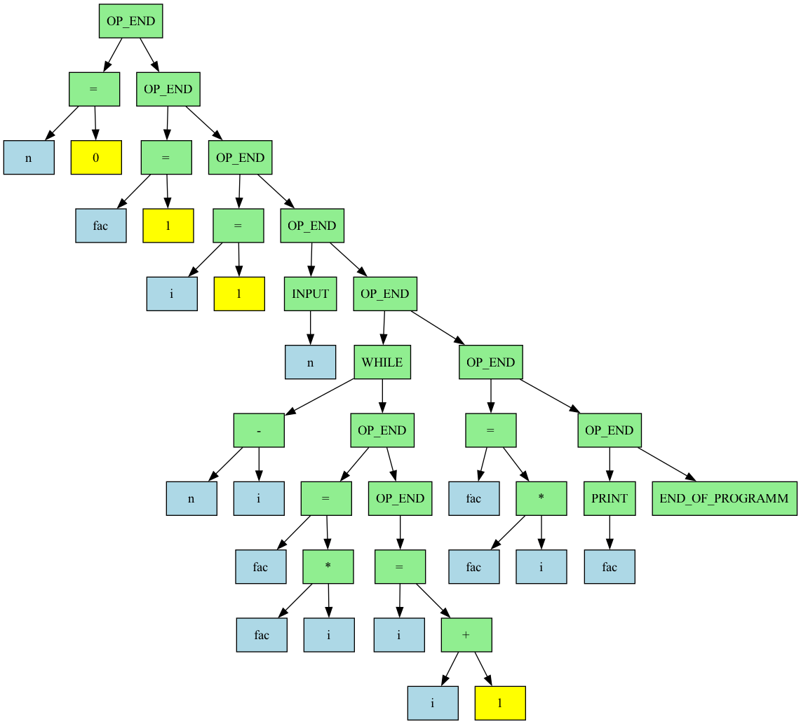

# My-little-Python

A modular educational compiler, assembler, and stack-based virtual machine built in C++. This project implements a complete end-to-end translation pipeline—from parsing high-level custom source code into an Abstract Syntax Tree (AST) to generating assembly, bytecode, and executing it on a custom virtual machine.

## 📝 Language Syntax & Features

The programming language processed by the **Front-End** module (`infix_read.cpp`) features a distinctive, thematic syntax heavily inspired by the Adeptus Mechanicus (Machine God / Omnissiah motif), combining standard algebraic infix notation with verbose, ritualistic commands.

### 1. Variables and Assignment

Variables do not require explicit type declarations. Assignment uses a dedicated phrase:

* **Syntax**: `variable присвой значение этой частице Омниссии expression;`
* **Example**:
  ```
  fac присвой значение этой частице Омниссии 1;
  ```

### 2. Arithmetic Operations

Mathematical expressions support standard infix operators, operator precedence, and parentheses. Crucially, arithmetic operations use explicit descriptive phrases instead of traditional symbols:

* Addition: `сложи сии священные числа` (`+`)
* Subtraction: `вычти сии священные числа` (`-`)
* Multiplication: `умножь сии священные числа` (`*`)
* Division: `раздели сии священные числа` (`/`)
* **Example**:
  ```
  i присвой значение этой частице Омниссии i сложи сии священные числа 1;
  ```

### 3. Control Flow & Blocks

* **Conditional Statements (`if`)**:

  ```
  Ежели, хвала Омниссиии (condition) operation;
  ```
* **Loops (`while`)**:

  ```
  До тех пор, пока, волею Омниссии (condition)
  Именем Омниссии, исполни
      # body statements
  Вознеси хвалу Омниссии;
  ```
* **Complex Operators (Braces/Scopes)**: Code blocks are opened with `Именем Омниссии, исполни` and closed with `Вознеси хвалу Омниссии;`.

### 4. Input / Output & Program Termination

* **Input**: `Потребуй у адепта Бога-Машины значение числа (variable);`
* **Output (Print)**: `Поделись с адептом священным значением выражения(expression);`
* **Program End**: Every script must conclude with a final blessing:
  ```
  Поблагодари святой когитатор за успешное выполнение
  ```

## 🚀 Execution Pipeline (Step-by-Step)

To translate and execute a source file written in the Omnissiah language (e.g., `programm.txt`), run the compiled binaries sequentially in the following order:

### Step 1: Front-End Parser (`front_end.out`)

Parses the high-level language source file into an Abstract Syntax Tree (AST) stored in an intermediate text representation.

* **Arguments**: `<source_code_file>`
* **Command**:
  ```bash
  ./front_end.out programm.txt
  ```
* **Output**: Generates/updates the intermediate AST tree representation file (e.g., `tree.txt`).

### Step 2: Middle-End Optimizer (`simplification.out`)

Reads the AST file, performs constant folding and equation simplification, and overwrites the file with the optimized AST.

* **Arguments**: `<ast_tree_file>`
* **Command**:
  ```bash
  ./simplification.out output.txt
  ```

### Step 3: Back-End Assembly Generator (`back_end.out`)

Traverses the optimized AST and emits low-level assembly code.

* **Arguments**: `<ast_tree_file> <output_asm_file>`
* **Command**:
  ```bash
  ./back_end.out output.txt asm.asm
  ```
* **Output**: Generates human-readable assembly instructions (`asm.asm`).

### Step 4: Assembler (`asm.out`)

Translates the text assembly into raw machine bytecode.

* **Arguments**: `<asm_file> <output_bytecode_file>`
* **Command**:
  ```bash
  ./asm.out asm.asm bitecode.txt
  ```
* **Output**: Generates machine bytecode executable by the VM (`output.txt`).

### Step 5: Processor / Virtual Machine (`processor.out`)

Loads and executes the compiled bytecode on the custom stack-based VM.

* **Arguments**: `<bytecode_file>`
* **Command**:
  ```bash
  ./processor.out bite_code.txt
  ```

## 🌲 AST Visualization (Tree Dump)

The compiler supports generating visual representations of the Abstract Syntax Tree to inspect parsing and optimization passes:




